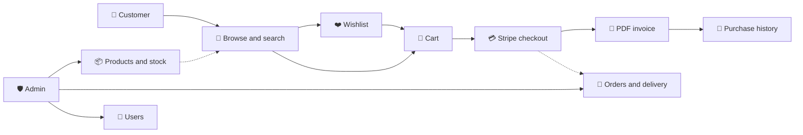

<div align="center">


<a href="https://github.com/Isuru-CodeX/PowerRig">
  
</a>

<br/>

<p>
  
  
  
  
  
</p>

<p>
  
  
  
  
  
</p>

<p>
  <a href="#-features"><b>✨ Features</b></a> •
  <a href="#-how-it-works"><b>🔄 How It Works</b></a> •
  <a href="#-getting-started"><b>🚀 Get Started</b></a> •
  <a href="#-project-structure"><b>📂 Structure</b></a> •
  <a href="#-roadmap"><b>🗺️ Roadmap</b></a>
</p>

</div>

---

## 🖥️ About

**PowerRig** is a robust, full-stack, PHP-driven web app built for **PC parts, gaming gear and computer accessories** stores. It covers the entire customer journey: shoppers browse the catalogue, save favourites to a **wishlist**, fill a **cart** and pay through a **Stripe** checkout, then download an automatically generated **PDF invoice**.

Designed as a **single-vendor platform**, it ships with an admin dashboard where store owners manage products, stock, orders and users from one place.

<!--
📸 SCREENSHOTS: add your images to an /assets folder, then uncomment this block.

<div align="center">
  
  
  
  
</div>
-->

---

## ✨ Features

### 🛒 For Customers

| | Feature | Details |
|---|---|---|
| 🔐 | **Account management** | Registration, login, profile editing, email verification and password reset |
| 🔎 | **Product discovery** | Advanced search, filters and dynamic category navigation |
| ❤️ | **Wishlist and cart** | Save items for later or add them straight to a responsive cart |
| 💳 | **Secure checkout** | Integrated **Stripe** payment gateway |
| 🧾 | **Orders and PDF invoices** | Purchase history dashboard and auto-generated downloadable invoices |
| 📱 | **Responsive design** | Bootstrap 5 layout for desktop, tablet and mobile |

### 🛡️ For Administrators

| | Feature | Details |
|---|---|---|
| 📊 | **Dashboard and analytics** | Key metrics, recent orders and a sales overview |
| 📦 | **Product management** | Add items with multiple images, edit details, manage stock and pricing, toggle visibility |
| 🚚 | **Orders and delivery** | Track orders, update delivery fees by region, change invoice and fulfilment status |
| 👥 | **User administration** | View users, block or unblock accounts |
| 🏷️ | **Brands and categories** | Add and link brands, categories and models |

---

## 🔄 How It Works



---

## 🛠️ Tech Stack

<div align="center">


</div>

| Layer | Technologies |
|---|---|
| **Frontend** | HTML5, CSS3, Vanilla JavaScript (AJAX), Bootstrap 5 |
| **Backend** | PHP (core procedural and object-oriented, no heavy MVC framework) |
| **Database** | MySQL via a custom `mysqli` wrapper class (no ORM) |
| **Integrations** | Stripe PHP SDK (payments), PHPMailer (email), FPDF (PDF invoices) |
| **Tools** | Git, Composer |

---

## 🚀 Getting Started

### ✅ Prerequisites

- 🧰 A local server stack (**XAMPP**, **WAMP** or **LAMP**) with PHP and MySQL
- 🎼 [Composer](https://getcomposer.org/) installed globally
- 🔧 Git
- 💳 A [Stripe](https://stripe.com/) account for test API keys

### 📥 Installation

```bash
# 1️⃣ Clone the repository
git clone https://github.com/Isuru-CodeX/PowerRig.git
cd PowerRig

# 2️⃣ Install Stripe and PHPMailer
composer install
```

### 🗄️ Database setup

1. Start Apache and MySQL (for example from the XAMPP control panel)
2. In phpMyAdmin, create a database named **`powerRig`**
3. Import **`database/powerRig.sql`**
4. Update the connection in `connection.php`:

```php
Database::$connection = new mysqli("localhost", "root", "your_password", "powerRig", "3306");
```

### ⚙️ Configuration

This project doesn't use `.env` files yet, so keys are set directly in the process files:

| What | Where to update |
|---|---|
| 💳 **Stripe test secret key** | `paymentProcess.php` (and any other relevant files) |
| 📧 **SMTP credentials (PHPMailer)** | `verificationProcess.php`, `forgotPasswordProcess.php` |

> 🔒 **Never commit real passwords or API keys.**

### ▶️ Run it

1. Place the `PowerRig` folder in your web root (`htdocs` for XAMPP, `www` for WAMP)
2. Start Apache and MySQL
3. Open **http://localhost/PowerRig/index.php**

---

## 📂 Project Structure

```bash
PowerRig/
├── 📁 database/              # powerRig.sql (database structure)
├── 📁 font/                  # Font definitions for FPDF invoices
├── 📁 invoices/              # Auto-generated PDF invoices
├── 📁 resources/             # Product images and site media
├── 📁 vendor/                # Composer deps (Stripe, PHPMailer)
├── 📄 composer.json
├── 📄 connection.php         # Custom MySQL connection wrapper
├── 📄 index.php              # Application entry point
├── 📄 adminDashboard.php     # Admin dashboard
├── 📄 paymentProcess.php     # Stripe checkout logic
├── 📄 script.js              # Frontend logic and AJAX calls
└── 📄 README.md
```

<details>
<summary><b>🔗 Key pages and what they do (click to expand)</b></summary>

<br/>

| File | Purpose |
|---|---|
| `userProfile.php`, `verificationProcess.php` | Profile management and email verification |
| `wishlist.php`, `cart.php` | Wishlist and shopping cart |
| `checkout.php`, `paymentProcess.php` | Checkout flow and Stripe payment |
| `purchasingHistory.php`, `invoice.php` | Order history and PDF invoice generation |
| `manageProducts.php`, `addProduct.php`, `updateProduct.php` | Product catalogue management |
| `manageDelivery.php`, `changeInvoiceStatusProcess.php` | Delivery fees and invoice status |
| `manageUsers.php` | User blocking and unblocking |
| `manageCategories.php`, `manageBrands.php` | Brand and category management |

</details>

---

## 🧪 Testing

No automated test framework is configured yet, so test manually:

- ✅ User registration and email verification
- ✅ Adding products (with multiple images) as admin
- ✅ Wishlist and cart flow
- ✅ Stripe checkout using [test cards](https://docs.stripe.com/testing)
- ✅ PDF invoice download

---

## ⚠️ Known Issues

- 📧 **Email deliverability:** verification and password-reset emails need valid SMTP credentials, otherwise those flows break.
- 🔐 **Security:** the custom database wrapper needs careful input handling. Watch for SQL injection risks when writing or changing raw queries.

---

## 🗺️ Roadmap

- [x] Full customer journey (browse → wishlist → cart → Stripe → invoice)
- [x] Admin dashboard with product, order, user and brand management
- [ ] Migrate to an **MVC** architecture
- [ ] Add an **ORM** for safer database access
- [ ] Add **PHPUnit** tests
- [ ] Move secrets to **`.env`** support

---

## 🤝 Contributing

Contributions are welcome! Found a bug or have an idea? Open an issue or submit a pull request.

1. 🍴 Fork the project
2. 🌿 Create a branch: `git checkout -b feature/AmazingFeature`
3. 💾 Commit: `git commit -m "Add AmazingFeature"`
4. 📤 Push: `git push origin feature/AmazingFeature`
5. 🔃 Open a Pull Request

## 📜 License

Licensed under the **MIT License**.

---

<div align="center">

### 📬 Connect with me

<a href="https://github.com/Isuru-CodeX"></a>

⭐ **If you like PowerRig, give it a star!** ⭐


</div>